# Situations de tir

Thème : armes

Questions illustrées : observer la scène et décider si le tir est possible.
Illustrations dessinées par `tools/dessiner-situations.mjs`.

## Ce sanglier se tient sur une crête, le ciel derrière lui. Pouvez-vous tirer à balle ? [éliminatoire]

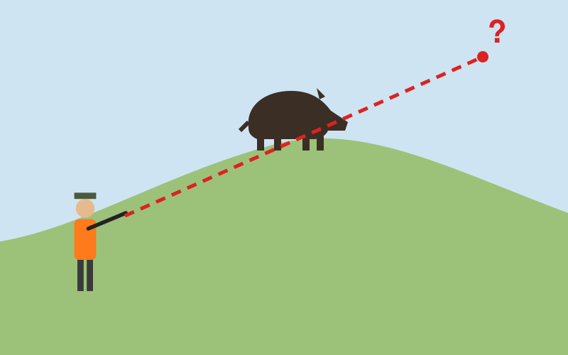

- [x] Non : sans terre derrière l'animal, la balle peut partir à plusieurs kilomètres
- [ ] Oui, car l'animal est bien visible
- [ ] Oui, si vous visez la tête
- [ ] Oui, si personne n'est visible sur la crête

> Un tir à balle doit toujours être fichant : la balle doit finir dans le sol, juste derrière l'animal. Un animal sur une crête se découpe sur le ciel, et la balle continuerait sa course au-delà, vers ce que vous ne voyez pas.

## Depuis ce mirador, vous voyez un chevreuil dans la prairie en contrebas. Le tir est-il possible ?

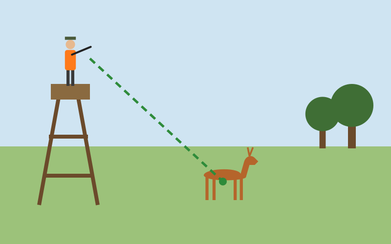

- [x] Oui : le tir est fichant, la balle finit dans le sol
- [ ] Non, il est interdit de tirer depuis un mirador
- [ ] Oui, mais seulement à la grenaille
- [ ] Non, il faut d'abord descendre au sol

> Le mirador permet justement de tirer de haut en bas : le sol sert de butte de tir et arrête la balle. Il faut toujours vérifier que l'animal est identifié et qu'il fait partie du plan de chasse.

## Un canard passe au-dessus de l'étang. Une maison se trouve sur l'autre rive. Que faites-vous ? [éliminatoire]

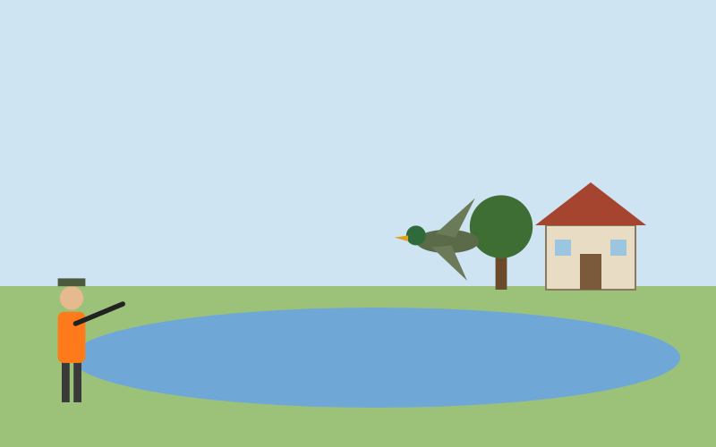

- [x] Vous ne tirez pas : la maison est dans la direction du tir et les plombs ricochent sur l'eau
- [ ] Vous tirez, la grenaille ne porte pas jusqu'à la maison
- [ ] Vous tirez au ras de l'eau
- [ ] Vous tirez quand le canard est au-dessus de la maison

> Il est interdit de tirer en direction des habitations à portée d'arme. Sur l'eau, les plombs ricochent et partent dans des directions imprévisibles.

## Un faisan file vers la haie. Un promeneur marche derrière. Pouvez-vous tirer ? [éliminatoire]

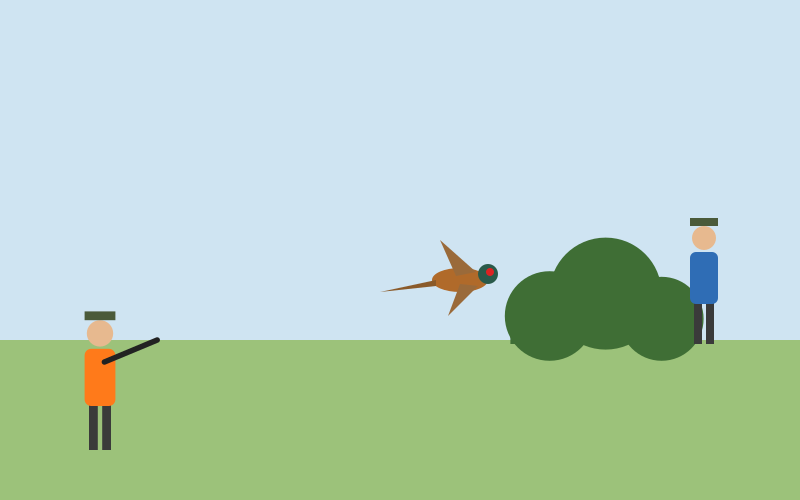

- [x] Non : le promeneur est dans l'axe du tir, même caché par la haie
- [ ] Oui, la haie arrête les plombs
- [ ] Oui, si vous tirez avant la haie
- [ ] Oui, en criant pour prévenir le promeneur

> Une haie n'arrête pas les plombs. On ne tire jamais en direction d'une personne, visible ou non, ni vers un endroit qu'on ne voit pas.

## Une forme sombre bouge dans le roncier. Vous ne voyez pas l'animal en entier. Que faites-vous ? [éliminatoire]

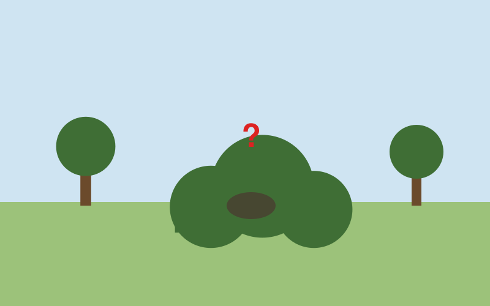

- [x] Vous ne tirez pas tant que l'animal n'est pas formellement identifié
- [ ] Vous tirez, c'est sûrement un sanglier
- [ ] Vous tirez au centre du buisson
- [ ] Vous tirez dans le bas pour toucher les pattes

> Une forme qui bouge peut être un chien, un traqueur ou un promeneur. Le doute doit toujours profiter à la sécurité.

## Un sanglier traverse au bord de la route. Une voiture arrive. Pouvez-vous tirer ? [éliminatoire]

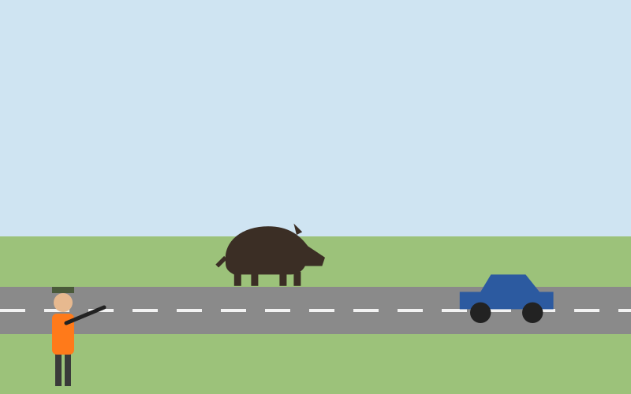

- [x] Non : il est interdit de tirer en direction ou au-dessus d'une route
- [ ] Oui, si vous tirez avant que la voiture arrive
- [ ] Oui, si la route est une petite route
- [ ] Oui, la balle passera derrière la voiture

> Il est interdit de tirer en direction, au-dessus ou le long des routes, des chemins publics et des voies ferrées, quelle que soit la circulation.

## Un lièvre se lève dans cette plaine dégagée, sans personne autour. Pouvez-vous tirer à la grenaille ?

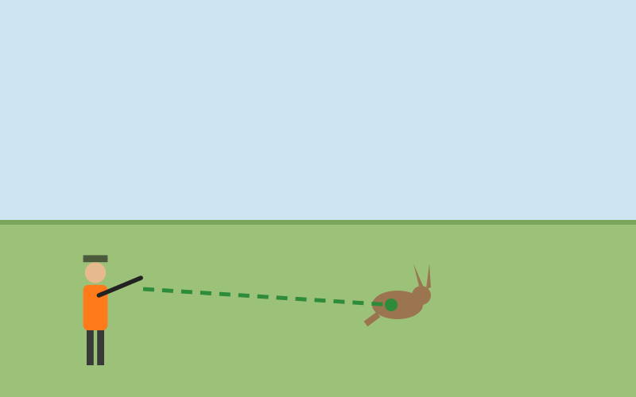

- [x] Oui, s'il est à portée efficace (moins de 35 à 40 m) et que la chasse du lièvre est ouverte
- [ ] Non, le lièvre se tire uniquement à balle
- [ ] Oui, à n'importe quelle distance
- [ ] Non, on ne tire jamais un animal qui court

> Rien n'est dans l'axe du tir et l'arrière-plan est sûr. Au-delà de 40 m, le risque est de blesser l'animal sans le tuer.

## Les chiens tiennent le sanglier au ferme. Pouvez-vous tirer ? [éliminatoire]

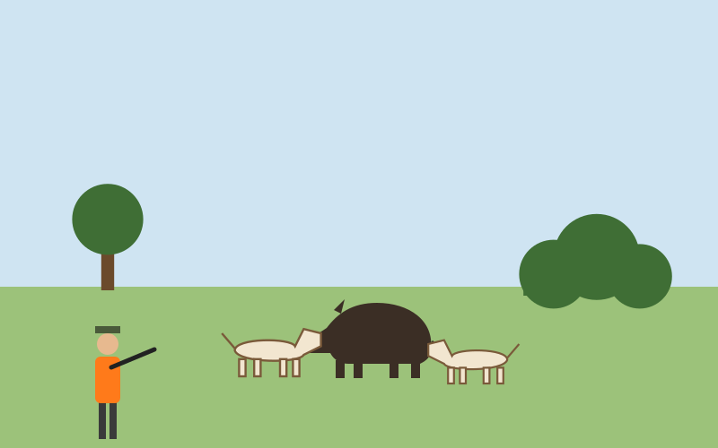

- [x] Non, sauf si vous êtes certain de ne pas toucher un chien et que l'arrière-plan est sûr, en approchant avec le conducteur des chiens
- [ ] Oui, tout de suite, à travers les chiens
- [ ] Oui, en tirant au-dessus des chiens
- [ ] Oui, car le sanglier ne bouge plus

> Les chiens bougent sans cesse autour de l'animal : un tir précipité risque de les blesser. On s'approche prudemment pour tirer à courte distance, sans chien dans l'axe.

## En battue, ce sanglier passe dans l'angle de 30° de votre voisin. Que faites-vous ? [éliminatoire]

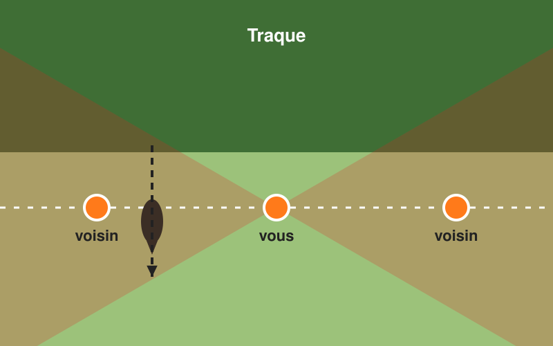

- [x] Vous ne tirez pas
- [ ] Vous tirez s'il est plus près de vous que de votre voisin
- [ ] Vous tirez en prévenant votre voisin
- [ ] Vous tirez à hauteur des pattes

> On ne tire jamais dans l'angle de 30° de part et d'autre de la direction d'un voisin : la zone rouge du plan. L'animal sera tiré plus loin, ou par un autre chasseur.

## En battue, ce sanglier a franchi la ligne des postes et s'éloigne derrière vous, hors des angles des voisins. Pouvez-vous tirer ?

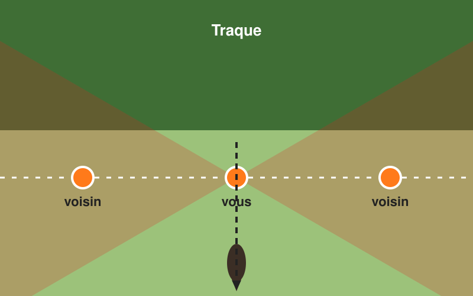

- [x] Oui, s'il est identifié, hors des angles de 30° et avec un arrière-plan sûr
- [ ] Non, on ne tire jamais derrière la ligne
- [ ] Oui, même s'il passe près d'un voisin
- [ ] Non, il faut attendre la fin de la battue

> Tirer l'animal qui a franchi la ligne évite de tirer vers les traqueurs. Il faut tout de même que le tir soit fichant et hors des angles de sécurité.

## En chasse en ligne, une perdrix repart en arrière entre vous et votre voisin. Que faites-vous ? [éliminatoire]

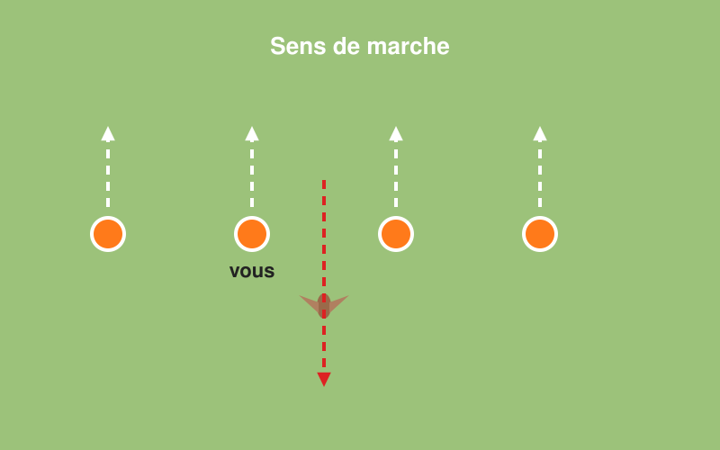

- [x] Vous ne tirez pas en balayant la ligne : vous ne tirez qu'après vous être retourné, si personne n'est dans l'axe
- [ ] Vous tirez en pivotant avec l'arme épaulée
- [ ] Vous tirez à hauteur d'homme
- [ ] Vous demandez à votre voisin de se baisser

> En pivotant arme épaulée, le canon passe devant les autres chasseurs. On abaisse l'arme, on se retourne, puis on tire seulement si l'axe est libre.

## Ce chevreuil se tient en lisière, une maison derrière lui. Pouvez-vous tirer ? [éliminatoire]

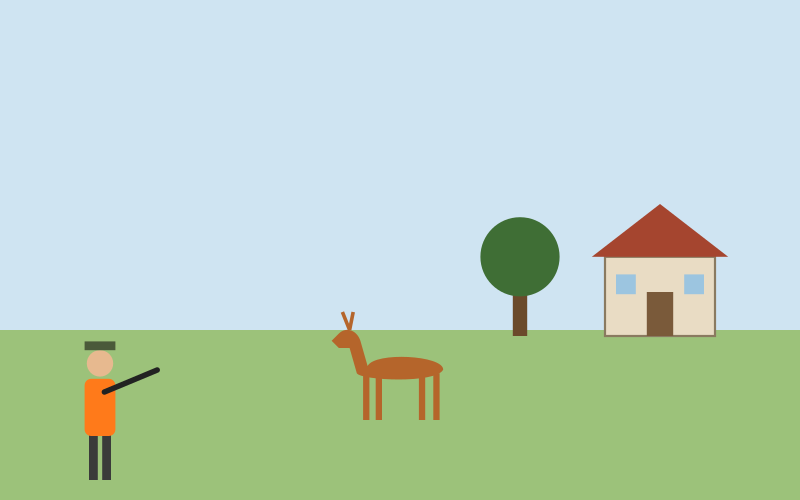

- [x] Non : la maison est dans l'axe du tir
- [ ] Oui, si la maison est à plus de 100 m
- [ ] Oui, si les volets sont fermés
- [ ] Oui, à la grenaille

> Une balle peut traverser l'animal ou le manquer et porter à plusieurs kilomètres. On ne tire jamais en direction d'une habitation à portée d'arme. Le grand gibier ne se tire pas à la grenaille.
